# Sauna Configurator Platform: System Design

> **Status:** design v1.0 for review. Region: **EU (Frankfurt, `eu-central-1`)**. Stack: React + React Three Fiber, AWS serverless (Lambda, API Gateway, CloudFront, S3), **Amazon RDS for PostgreSQL**, Cognito, SES.
> **Companion file:** [`schema.sql`](./schema.sql), the complete PostgreSQL schema (51 tables, constraints, triggers, row-level security, roles, seed data). It was executed against a real Postgres engine with 52 automated rule checks (see [section 7.8](#78-how-the-schema-was-verified)).

---

## Table of contents

1. [Goals and scope](#1-goals-and-scope)
2. [Assumptions and open decisions](#2-assumptions-and-open-decisions)
3. [Requirements traceability](#3-requirements-traceability)
4. [Architecture](#4-architecture)
5. [Multi-tenancy and routing](#5-multi-tenancy-and-routing)
6. [Authentication and authorisation](#6-authentication-and-authorisation)
7. [Data model (5NF)](#7-data-model-5nf)
8. [Pricing engine](#8-pricing-engine)
9. [Configuration, sharing, requests](#9-configuration-sharing-requests)
10. [3D assets: protection and AR](#10-3d-assets-protection-and-ar)
11. [Lazy loading and frontend performance](#11-lazy-loading-and-frontend-performance)
12. [Caching strategy](#12-caching-strategy)
13. [API design](#13-api-design)
14. [Notifications](#14-notifications)
15. [Security, privacy and GDPR](#15-security-privacy-and-gdpr)
16. [Capacity and scalability](#16-capacity-and-scalability)
17. [Observability and operations](#17-observability-and-operations)
18. [Delivery: IaC, CI/CD, environments, catalog import](#18-delivery-iac-cicd-environments-catalog-import)
19. [Backup and disaster recovery](#19-backup-and-disaster-recovery)
20. [Testing strategy](#20-testing-strategy)
21. [Risks](#21-risks)
22. [Roadmap](#22-roadmap)
23. [Repository layout](#23-repository-layout)
24. [Launch checklist](#24-launch-checklist)
25. [Diagram index](#25-diagram-index)

---

## 1. Goals and scope

A standalone, deployable **sauna configurator platform** on AWS, owned by one **manufacturer** who sells through **resellers**.

| Tier | Who | Can do |
|---|---|---|
| **Platform maintainers** | Us | Build 3D models, import catalog data, operate the platform. There is **no admin UI for adding saunas**; the catalog is data-driven, so adding a sauna is a data import and not an application deployment. |
| **Manufacturer** | Owner of the platform instance, hundreds of saunas | Admin panel: add/suspend resellers, assign saunas and rooms to resellers, set **list ("max") prices** and the **maximum allowed discount** per sauna and currency, view reseller-level analytics. |
| **Reseller** (about 500) | Tenant on its own subdomain `{slug}.<platform-domain>` | Admin panel: brand the storefront (logo, favicon, colours), choose visibility and order of assigned saunas (for example 15), set **discounts** (percent or fixed) within manufacturer limits, configure saunas for customers, generate **expiring share links**, work **requests** through a status workflow. |
| **Customer** (about 1 M accounts, scoped per reseller) | End user | Browse the reseller's saunas without an account (view only). Sign up or log in to configure, place the sauna in a **room** scene or in **AR**, keep history, and send a **request**. |

**Out of scope for v1:** a catalog-editing UI (maintainers use the import pipeline), reseller custom domains (subdomains only), online payment and checkout, ERP integration, multi-manufacturer SaaS (the schema is ready; the product is single-manufacturer).

---

## 2. Assumptions and open decisions

Everything the requirements did not state is listed here, so nothing is hidden. **Items in bold need a decision before build; the rest are safe defaults.**

| # | Topic | Assumption used in this design | Status |
|---|---|---|---|
| A1 | Region | Primary `eu-central-1` (Frankfurt). Backups and S3 replicas in `eu-west-1` (Ireland), so data stays in the EU. | Given ("Europe") |
| A2 | Peak concurrency | **2,000 concurrent sessions** typical peak, with headroom designed to 5,000. | **Please confirm** |
| A3 | Model size | High-quality sauna GLB about **8-12 MB** compressed, low-LOD ≤ 1.5 MB, AR GLB ≤ 5 MB. These are budgets to hit, not measurements. | **Validate with a real model** |
| A4 | Default share-link expiry | **30 days**; each reseller can set 1-90 days; a single link can override within the same bounds. | **Please confirm** |
| A5 | Currency | One currency per reseller. The manufacturer sets list prices **per currency**; a sauna can only be assigned to a reseller if it has a price in that currency. | Given, price model assumed |
| A6 | "Max price" | The manufacturer's price is a **ceiling/list price**. Resellers can only **discount** from it (percent or fixed), capped by the manufacturer's `max_discount_bps`. | Interpretation, confirm |
| A7 | Anonymous visitors | See catalog, specs, thumbnails and a **low-LOD view-only 3D viewer**. High-quality 3D, configuring, rooms and AR need a customer login. | Interpretation, confirm |
| A8 | Rooms | A **separate object**: preset 3D room scenes (manufacturer-owned, assigned per reseller) in which a configured sauna is placed. AR is separate (device camera). | Interpretation of "different object" |
| A9 | Customer accounts | Per reseller. Same e-mail at two resellers = two independent accounts. | Given |
| A10 | Manufacturer access to customer PII | **No** by default. The manufacturer sees reseller-level metrics and non-personal data. The reseller is the GDPR controller for its customers. Enforced in the database (section 7.6). | **Confirm with legal / contract** |
| A11 | E-mail sender | Platform sending domain; display name = reseller name; Reply-To = reseller support address. | **Please confirm** |
| A12 | VAT / tax | Not modelled in v1. Prices are shown "as entered". | **Decide inc./excl. VAT per reseller** |
| A13 | Platform domain | Written as `<platform-domain>` (for example `saunas.example.com`). | **Need real domain** |
| A14 | Cognito at 1 M accounts | Cost depends on monthly active users and plan; **verify current pricing** before committing. Fallback: in-house auth on the same DB. | **Check with Nikhil** (as in the original brief) |
| A15 | IaC tool | Terraform. CDK is an equal alternative. | Preference needed |
| A16 | Language | UI and catalog in English at launch; translation tables exist for models, option groups and options. | Confirm languages |

---

## 3. Requirements traceability

| Requirement (original brief and follow-ups) | Where addressed |
|---|---|
| Standalone, deployable software on AWS | Sections 4, 18 |
| Login, password reset, e-mail verification | Section 6 (Cognito, backend-for-frontend) |
| Add saunas without redeploy (we are the maintainers) | Section 18.4 (catalog import), data model section 7 |
| Capture full customer information | `customers`, `customer_addresses`, `customer_consents` (7.4) |
| Generate and share a link per configuration | Section 9.3, `share_links` |
| Manufacturer with hundreds of saunas, admin panel, max price | Sections 7, 8, 13 (manufacturer API) |
| Resellers with own subdomain, own admin panel, discounts, branding and favicon | Sections 5, 8, 13 |
| Reseller sees a subset (for example 15 saunas); customers view but cannot configure without login | Sections 6.3, 7 (`reseller_saunas`), A7 |
| Login and sign-up for customers; history of requests | Sections 6, 9 |
| Request workflow: e-mail, status workflow and panel list | Sections 9.4, 14 |
| 3D view, room view, AR | Sections 10, 11 |
| Assets not downloadable (as far as possible) | Section 10 (and its honest limits) |
| Lazy loading, caching, basics | Sections 11, 12 |
| 500 resellers, 1 M customers | Section 16 |
| One currency per reseller | Sections 7, 8 |
| Europe region | A1, section 15 |
| Normalisation to 5NF | Section 7.2 |

---

## 4. Architecture

### 4.1 System context (Diagram 1)

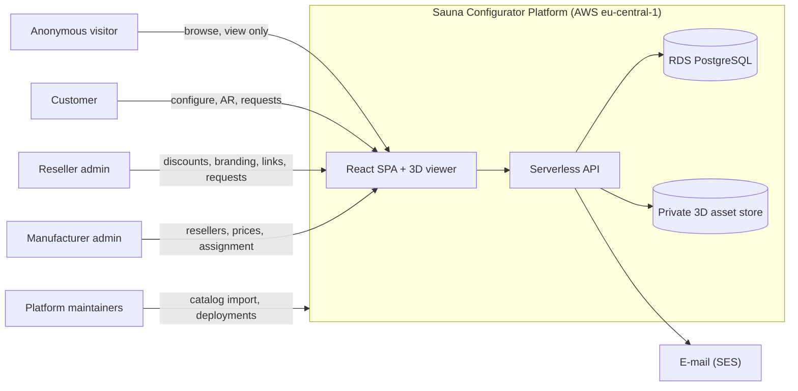

### 4.2 AWS architecture (Diagram 2)

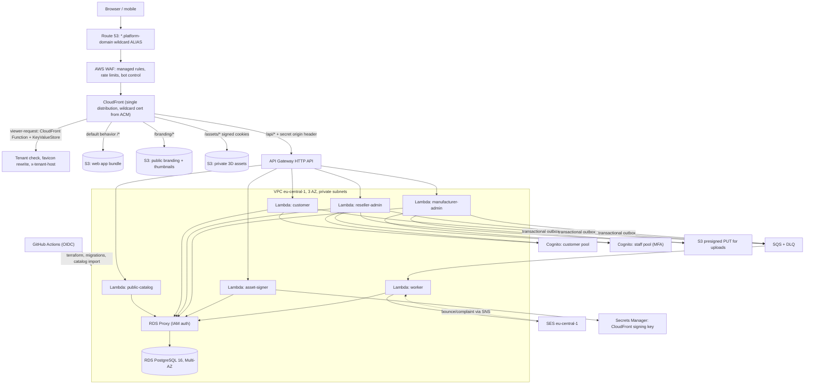

**Why one CloudFront distribution:** the web app, the API (`/api/*`) and protected assets (`/assets/*`) all live on each reseller's own host. That gives **same-origin requests (no CORS)**, **host-scoped cookies** (a cookie issued for `alpha.<domain>` can never be used on `beta.<domain>`), and one place for WAF, caching and TLS.

**Why six Lambda functions and not one:** separate IAM roles and DB users (least privilege). The manufacturer-admin function is the only one with write access to prices and reseller assignment; the customer function never holds that permission, even if compromised.

### 4.3 Network and security layers (Diagram 3)

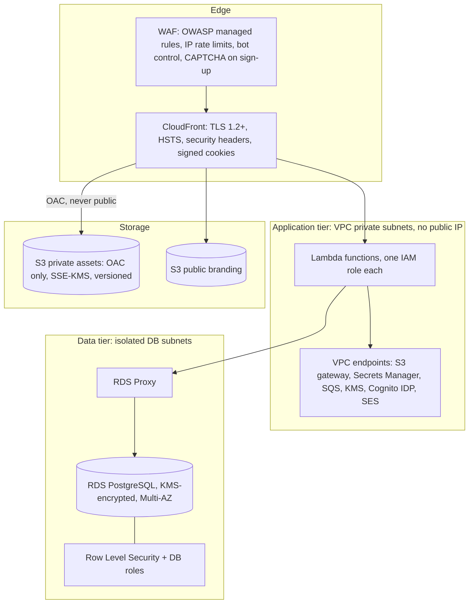

---

## 5. Multi-tenancy and routing

**Model:** one shared stack, one shared database schema; every tenant-owned row carries `reseller_id`. A new reseller is **a row, not a deployment** (no DNS change, no certificate change, no redeploy).

### 5.1 Tenant resolution (Diagram 4)

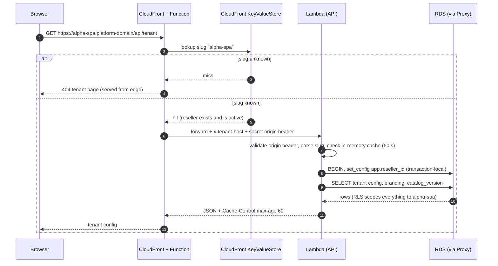

Key rules:

- **The tenant comes only from the Host header** (validated against a strict slug pattern), **never** from a client-supplied parameter or header.
- Every database transaction begins with `SELECT set_config('app.reseller_id', $1, true)`. Row-Level Security then makes cross-tenant reads and writes impossible even if application code has a bug (section 7.6).
- Reserved slugs (`www`, `api`, `admin`, ...) are enforced in the database (`reserved_slugs` plus trigger).
- The manufacturer admin panel lives at `admin.<platform-domain>`; resellers manage themselves at `{slug}.<platform-domain>/admin`.
- The CloudFront KeyValueStore holds slug → status so unknown or suspended tenants are rejected **at the edge**; it is updated by the `worker` function whenever a reseller is created or its status changes.

### 5.2 Per-tenant branding and favicon

- Branding (logo, favicon, colours, display name) is stored in `reseller_branding` and loaded at runtime from `/api/tenant` (cached 60 s, versioned by `catalog_version`).
- **Favicon:** a CloudFront Function rewrites `/favicon.ico` and `/branding/favicon-*.png` to the tenant's files (`/branding/{slug}/...`), so browsers and crawlers get the right icon even before JavaScript runs. The SPA also sets `<title>` and the theme colour at runtime.
- Uploads: the reseller admin requests a presigned S3 PUT, uploads, and the API validates and re-encodes the image (PNG/WebP/ICO only; **SVG is rejected** in v1 to avoid script injection), generates the favicon sizes, then writes the `assets` row.
- Known limit: link previews (Open Graph tags) for share links are generic in v1. Per-tenant previews need edge rendering and are a v2 item.

---

## 6. Authentication and authorisation

### 6.1 Design decisions

| Decision | Choice | Reason |
|---|---|---|
| Identity provider | **Amazon Cognito**, **two user pools** (`customers`, `staff`) | Login, password reset and e-mail verification out of the box, as proposed in the brief. Staff pool enforces MFA. |
| Customer username | **`customers.id` (UUID)**, not the e-mail | Cognito usernames must be unique per pool, while the same e-mail must be able to exist at two resellers. The e-mail is only an attribute, with no aliases enabled. |
| Pools per reseller | **No** | 500 pools would be unmanageable. Tenant scoping lives in the database and the BFF. |
| Token handling | **Backend-for-frontend (BFF)** | The browser never sees Cognito tokens. The API sets `HttpOnly; Secure; SameSite=Lax` cookies, and the SPA never touches a token. |
| Login lookup | BFF resolves `(reseller from host, e-mail)` → `customers.id` → Cognito `InitiateAuth` | The user types only e-mail and password. |

### 6.2 Customer flows (Diagram 5)

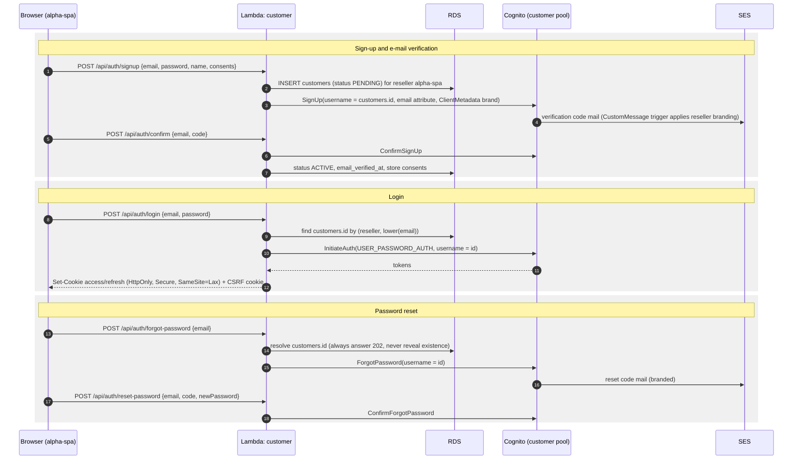

Security properties: generic responses prevent account enumeration; WAF rate limits apply per IP on auth routes; CSRF protection is a double-submit token on every state-changing request; refresh-token rotation and a `/logout` that revokes the refresh token; staff pool requires TOTP MFA.

### 6.3 Roles and permission matrix

| Capability | Anonymous | Share-link viewer | Customer | Reseller admin | Manufacturer admin |
|---|:--:|:--:|:--:|:--:|:--:|
| View storefront, specs, thumbnails | ✅ | ✅ | ✅ | ✅ | ✅ |
| Low-LOD 3D view (view only) | ✅ | ✅ | ✅ | ✅ | ✅ |
| High-LOD 3D, rooms, AR | ❌ | ✅ (that configuration) | ✅ | ✅ | ✅ |
| Configure a sauna | ❌ | ❌ | ✅ | ✅ (also on behalf of customers) | ❌ |
| Save history, send request | ❌ | ❌ | ✅ | ❌ | ❌ |
| Create / revoke share links | ❌ | ❌ | ❌ | ✅ | ❌ |
| Set discount (within cap) | ❌ | ❌ | ❌ | ✅ | ❌ |
| Edit own branding | ❌ | ❌ | ❌ | ✅ | ❌ |
| Work requests (status, notes, quote) | ❌ | ❌ | own requests (read, cancel) | ✅ own reseller | ❌ (no customer PII, A10) |
| Show or hide assigned saunas | ❌ | ❌ | ❌ | ✅ | ✅ |
| Create resellers, assign saunas and rooms | ❌ | ❌ | ❌ | ❌ | ✅ |
| Set list prices and max discount | ❌ | ❌ | ❌ | ❌ | ✅ |
| Reseller-level analytics | ❌ | ❌ | ❌ | own | ✅ all |
| Read customer PII | ❌ | ❌ | own | own reseller | ❌ |

Authorisation is enforced in **three layers**: (1) route middleware checks the role from the verified JWT, (2) the application layer checks ownership, (3) PostgreSQL **RLS and grants** are the final backstop.

---

## 7. Data model (5NF)

### 7.1 Principles

- **PostgreSQL 16 on Amazon RDS** (decision from the brief: RDS). PostgreSQL gives us Row-Level Security, partial and expression indexes, `jsonb` for audit details and composite foreign keys.
- **UUID primary keys** (`gen_random_uuid()`); identity `bigint` for append-only logs.
- **Money:** `bigint` minor units plus a currency code. No floats anywhere.
- **Percentages:** basis points (1000 = 10.00 %).
- **Lookup tables** for workflow-like or extensible sets (request statuses and transitions, asset roles, currencies, countries). `CHECK` constraints for small closed sets that never need data-driven changes (for example `SINGLE`/`MULTI`).
- **Composite foreign keys** make cross-tenant mix-ups structurally impossible (for example a configuration cannot point at another reseller's customer).
- **51 tables** in total ([catalog in 7.4](#74-table-catalog)).

### 7.2 Normalisation analysis

**Claim:** every table is in **BCNF**, and the multi-valued and join dependencies are separated, so the schema is in **4NF/5NF** with the explicit, justified exceptions listed below. This was derived by analysing the functional and join dependencies per table (it is a design argument, not output of a tool).

| Normal form | How the design satisfies it |
|---|---|
| **1NF** | Atomic columns only. No arrays or repeating groups. `jsonb` appears solely in event records (`audit_events.details`, `notification_outbox.payload`) that are never queried relationally. |
| **2NF** | Every non-key column depends on the **whole** key in composite-key tables. Example: a configuration's sauna model is **not** repeated in `configuration_selections`; it is reached through `configurations`. |
| **3NF / BCNF** | No transitive dependencies. Examples: the currency of a price is not stored on sellable rows (it is determined by the reseller, so `resellers.currency_code` is the single source); a protected-or-public flag is not stored on `assets` (it is determined by the asset's **role** in `asset_roles`). |
| **4NF** | Independent multi-valued facts never share a table. A sauna's **attributes**, **option groups**, **available options**, **asset files**, **translations** and **prices** each have their own table, so no table says "for each X, any combination of Y and Z". |
| **5NF** | Tables that look like three-way relationships are split so that no non-trivial join dependency remains. Example: availability of an option for a model (`sauna_model_options`), its price per currency (`sauna_model_option_prices`), and its dependency rules (`option_requires`, `option_excludes`) are separate relations that cannot be losslessly decomposed further and cannot be reconstructed by joining smaller tables. |

**Functional dependencies for the key tables**

| Table | Key | Dependencies (all determinants are keys, so BCNF holds) |
|---|---|---|
| `resellers` | `id`, also `slug` | `id → manufacturer, slug, name, currency, status, expiry days, version` |
| `customers` | `id`, also `(reseller_id, lower(email))` | `id → reseller, e-mail, names, phone, locale, status` |
| `sauna_model_prices` | `(sauna_model_id, currency_code)` | `→ list_price_minor, max_discount_bps` |
| `sauna_model_option_prices` | `(sauna_model_id, option_id, currency_code)` | `→ price_delta_minor` |
| `reseller_saunas` | `(reseller_id, sauna_model_id)` | `→ is_visible, sort_order` |
| `reseller_sauna_discounts` | `(reseller_id, sauna_model_id)` | `→ discount_type, discount_value` |
| `configurations` | `id` | `id → reseller, sauna model, customer, creator, name, locked_at` |
| `configuration_selections` | `(configuration_id, option_id)` | key only (pure association) |
| `configuration_requests` | `id`, also `configuration_id` | `id → customer, configuration, status, message` |
| `request_status_history` | `id` | `id → request, status, actor, note, time` |

**Deliberate, documented exceptions (not redundancy):**

1. `configuration_price_snapshots` stores computed prices at the moment of locking. It is a **historical fact**, not a derivable value: later price changes must not rewrite old quotes.
2. `resellers.catalog_version` is an operational cache-busting counter.
3. `audit_events` and `notification_outbox` carry `jsonb` event payloads, which by nature are immutable event records.
4. The rule "one option per `SINGLE` group in a configuration" cannot be expressed as a key without adding a derivable column, which would break BCNF. It is enforced by a trigger (7.5) instead.
5. A **constant** `applies_to` column in the three asset-link tables exists only to enforce, through a composite foreign key, that for example a room asset role cannot be attached to a sauna model.

### 7.3 Entity-relationship diagrams

#### Diagram 6: identity and tenancy

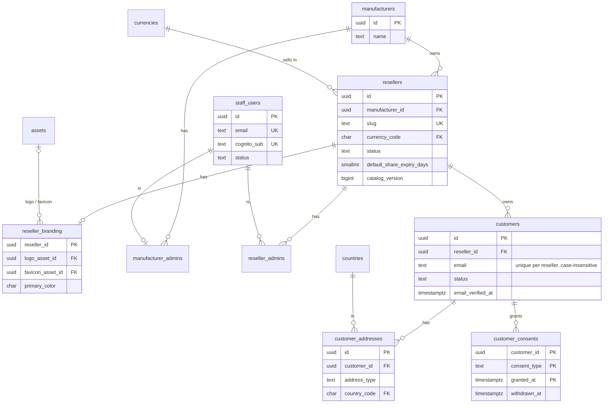

#### Diagram 7: catalog, pricing and reseller assignment

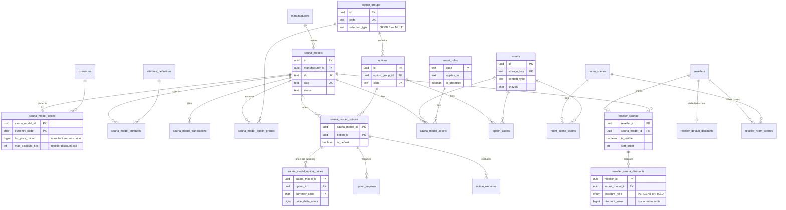

#### Diagram 8: configuration, sharing and requests

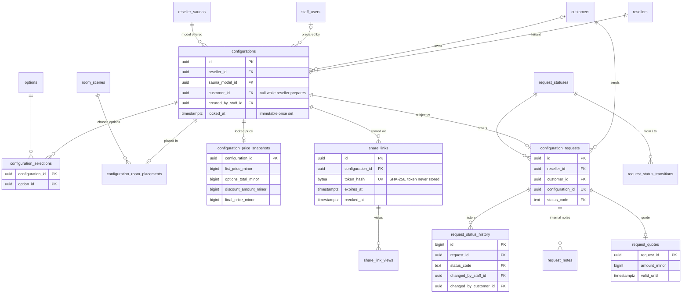

Supporting tables not drawn: `notification_outbox`, `email_suppressions`, `audit_events` (section 14), and the `*_translations` tables (section 7.4).

### 7.4 Table catalog

| Group | Table | Purpose |
|---|---|---|
| Reference | `currencies`, `countries` | ISO currencies (minor-unit digits) and countries |
| | `request_statuses`, `request_status_transitions` | Request workflow states and the allowed transition graph (data, not code) |
| | `asset_roles` | What a file is (high mesh, AR file, thumbnail, brand logo...), which entity type it applies to, and whether it is **protected** |
| | `reserved_slugs` | Subdomains resellers may not use |
| Tenancy | `manufacturers` | The owning manufacturer |
| | `resellers` | Tenant: slug, currency, status, share expiry, `catalog_version` |
| | `reseller_branding` | Logo, favicon, colours, support e-mail (1:1 with resellers) |
| | `assets` | Every stored file: unguessable key, type, size, SHA-256 |
| Identity | `staff_users` | Manufacturer and reseller admins (never hard-deleted) |
| | `manufacturer_admins`, `reseller_admins` | Which staff user administers what |
| | `customers` | Customer accounts, **unique per reseller** |
| | `customer_addresses` | Billing, shipping and site addresses |
| | `customer_consents` | Versioned, timestamped consent log (terms, privacy, marketing) |
| Catalog | `sauna_models` | The hundreds of saunas |
| | `sauna_model_translations`, `option_group_translations`, `option_translations` | Localised names and descriptions |
| | `attribute_definitions`, `sauna_model_attributes` | Technical specs (size, power, capacity), as dictionary plus values |
| | `sauna_model_prices` | **List ("max") price and maximum discount per model and currency** |
| | `option_groups`, `options` | Configuration choices (wood, heater, door, lighting...) |
| | `sauna_model_option_groups` | Which groups a model exposes (required or optional) |
| | `sauna_model_options` | Which options are valid for a model, plus defaults |
| | `sauna_model_option_prices` | Price delta per model, option and currency |
| | `option_requires`, `option_excludes` | Dependency rules between options (requires / mutually exclusive) |
| | `room_scenes` | Preset 3D room environments (a separate object from saunas) |
| | `sauna_model_assets`, `option_assets`, `room_scene_assets` | Files per entity, typed by role |
| Reseller catalog | `reseller_saunas` | Which saunas a reseller shows, plus visibility and order |
| | `reseller_sauna_discounts`, `reseller_default_discounts` | Per-sauna discount and fallback discount |
| | `reseller_room_scenes` | Which rooms a reseller offers |
| Configuration | `configurations` | A customer's (or reseller-prepared) configuration of one sauna |
| | `configuration_selections` | Chosen options |
| | `configuration_room_placements` | Where the sauna sits in a room scene (position, rotation, scale) |
| | `configuration_price_snapshots` | Price frozen at lock time |
| | `share_links`, `share_link_views` | Expiring links (hashed tokens) and view counts |
| Requests | `configuration_requests` | "Ask for configuration": one request per locked configuration |
| | `request_status_history` | Every status change, who and when |
| | `request_notes` | Internal reseller notes |
| | `request_quotes` | The reseller's quote (amount, validity) |
| Platform | `notification_outbox` | Transactional outbox for e-mail events |
| | `email_suppressions` | Bounced or complaining addresses (do not send) |
| | `audit_events` | Append-only audit trail |

### 7.5 Integrity rules enforced by the database

These hold regardless of application bugs. Each is covered by an automated check (7.8).

| Rule | Mechanism |
|---|---|
| A reseller can only discount from the list price, never beyond the manufacturer's cap (percent **and** fixed) | Trigger `trg_discount_within_cap` |
| A sauna can only be assigned to a reseller of the same manufacturer that has a price in the reseller's currency | Trigger `trg_reseller_sauna_assignable` |
| Reserved or malformed subdomain slugs are rejected | Trigger + `CHECK` on `resellers.slug` |
| A configuration can only use a sauna **the reseller offers** | Composite FK `(reseller_id, sauna_model_id) → reseller_saunas` |
| A configuration's customer must belong to the **same reseller** | Composite FK `(customer_id, reseller_id) → customers` |
| A configuration needs an owner (customer or staff) | `CHECK` |
| Selected options must be valid for the model; one option per `SINGLE` group; multiple for `MULTI` | Trigger `trg_configuration_selection_rules` (serialised per configuration with `FOR UPDATE`) |
| Once locked (shared or requested), a configuration and its selections are immutable | Triggers on `configurations` and `configuration_selections` |
| A request needs a locked configuration, and only one request exists per configuration | Trigger + `UNIQUE` |
| Request, customer and configuration always belong to the same reseller and the same customer | Three composite FKs on `configuration_requests` |
| Status changes follow the allowed graph only | Trigger against `request_status_transitions` |
| Price snapshot arithmetic is consistent (`final = list + options - discount`) | `CHECK` |
| Share-link tokens are never stored; hash length is enforced; expiry is after creation | `CHECK`, `UNIQUE` on `token_hash` |
| An option must belong to a group the model exposes | Trigger `trg_model_option_group_attached` |
| Asset role and target entity type must agree (no room role on a sauna) | Composite FK `(asset_role, applies_to) → asset_roles` |
| Customer e-mail is unique per reseller, case-insensitive | Unique index on `(reseller_id, lower(email))` |
| At most one default address per customer and type | Partial unique index |

### 7.6 Tenant isolation (RLS) and database roles

Three database roles, each used by specific Lambda functions through IAM authentication on RDS Proxy:

| DB role | Used by | Can |
|---|---|---|
| `app_tenant` | `public-catalog`, `customer`, `reseller-admin`, `asset-signer` | Read catalog and reference data; read and write **only rows of the current tenant** in tenant tables; update a reseller's own visibility, order, discounts, branding and share-expiry setting. **Cannot** change prices, resellers, assignments, or read the outbox. |
| `app_platform` | `manufacturer-admin`, `worker` | Create and update resellers, assignments, list prices, staff; run the outbox. **Cannot read customer PII** (RLS gives it zero rows on `customers`, `customer_addresses`, `customer_consents`, `configuration_requests` and the request child tables). |
| `catalog_admin` | Maintainers' import pipeline | Write catalog and asset tables only; can call `bump_all_catalog_versions()`. Cannot read any tenant data. |

How isolation works:

1. Each transaction starts with `SELECT set_config('app.reseller_id', '<uuid from the Host header>', true)`, which is **transaction-local**.
2. Every tenant-owned table has a policy `reseller_id = app_reseller_id()`. Child tables (for example selections, addresses, request notes) check through their parent.
3. If no tenant is set, queries return **zero rows** (fail closed). This is tested.
4. The "platform" privilege comes from **database role membership** (`pg_has_role`), never from a client-settable setting, so a tenant function cannot escalate by setting a variable.
5. PII tables deliberately exclude the platform role (assumption A10).

> **Operational note, RDS Proxy:** session-level `SET` statements cause connection pinning, which hurts multiplexing. The design uses only transaction-local `set_config(..., true)`. **Verify pinning with the RDS Proxy metric `DatabaseConnectionsCurrentlySessionPinned` during load tests** (section 20); if pinning appears, fall back to a fixed pool per function.

### 7.7 Indexing and growth

- Every foreign key used in joins is indexed; tenant-listing indexes start with `reseller_id` (for example `(reseller_id, created_at DESC)`, `(reseller_id, status_code, created_at DESC)`).
- Hot lookups: `share_links.token_hash` (unique), `customers (reseller_id, lower(email))`, `resellers.slug`.
- Expiry sweeps use a partial index on `share_links (expires_at) WHERE revoked_at IS NULL`.
- Rough volumes at the stated scale (1 M customers, about 3 configurations each, about 10 selections each): about 3 M configurations and about 30 M selection rows. This is **a few GB including indexes in year one**, which is comfortable for a single Multi-AZ PostgreSQL instance.
- `share_link_views` is the fastest-growing table. It has a BRIN index on time and is the first candidate for monthly partitioning (for example with `pg_partman`) and a retention job.

### 7.8 How the schema was verified

`schema.sql` was applied to an in-process PostgreSQL engine (PGlite, real Postgres code compiled to WebAssembly) and **52 checks passed, 0 failed**:

- the schema applies cleanly end to end;
- slug, discount-cap (percent and fixed), assignment, option-group, selection, lock, request and status-transition rules reject bad input and accept good input;
- the same e-mail can exist at two resellers, but not twice in one;
- tenant A cannot read or write tenant B's customers, addresses, configurations, requests or share links; with no tenant context nothing is visible;
- the platform role cannot read customer PII; the catalog role cannot read customers; tenants cannot change prices or create resellers;
- price changes bump `catalog_version` for the right resellers only.

**Not yet done:** tests on a managed RDS instance, load tests, and RDS Proxy pinning measurements. Those belong in the CI pipeline (section 20). The test script is not shipped with this README; port it to Testcontainers/Postgres 16 in CI.

---

## 8. Pricing engine

All pricing is computed **on the server**; the client only displays the result.

### 8.1 Rules

- All amounts are integers in the reseller's currency minor units.
- `list_price` comes from `sauna_model_prices` for `(model, reseller currency)`. This is the manufacturer's ceiling.
- `options_total` is the sum of `price_delta_minor` for the selected options in the reseller's currency.
- `subtotal = list_price + options_total`.
- Discount source: the reseller's **per-sauna** discount if present, otherwise the reseller's **default** discount, otherwise none.
- Percent discount: `floor(subtotal × bps / 10000)`. Fixed discount: `min(value, subtotal)`.
- **Cap:** the discount may never exceed `floor(subtotal × max_discount_bps / 10000)`. Per-sauna discounts are validated when written (database trigger). The default discount is validated against the lowest cap among assigned saunas when written and **clamped at calculation time**, so a manufacturer lowering a cap can never produce an over-discounted price.
- `final = subtotal - discount`, never below zero.
- Rounding: always toward zero (`floor`), consistently.

### 8.2 Calculation flow (Diagram 9)

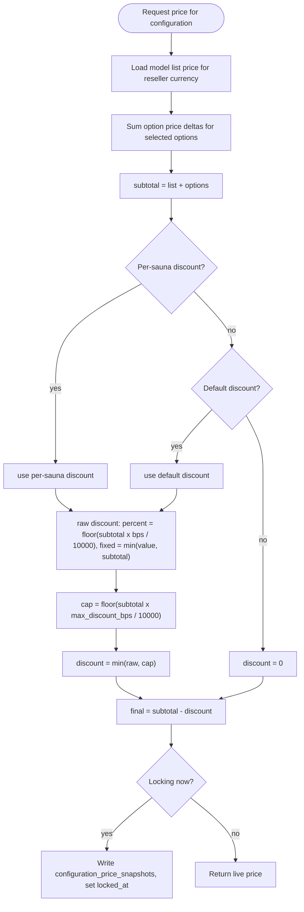

### 8.3 Changes to prices

A change to list prices, option prices, discounts, assignment, visibility or branding increments the affected resellers' `catalog_version` (database triggers), which busts the CDN cache (section 12). **Already locked configurations keep their price snapshot.**

---

## 9. Configuration, sharing, requests

### 9.1 Configuration lifecycle

1. **Draft:** a customer (or a reseller admin on behalf of a customer) creates a configuration for a sauna the reseller offers; selections are validated by option rules and the database. The live price is calculated on demand.
2. **Optional room placement:** a room scene and a position, rotation and scale (`configuration_room_placements`).
3. **Locked:** sharing or sending a request **locks** the configuration (`locked_at`) and writes the price snapshot in the same transaction. A locked configuration is immutable. To change it, the user clones it into a new draft.

### 9.2 Share, view and request (Diagram 10)

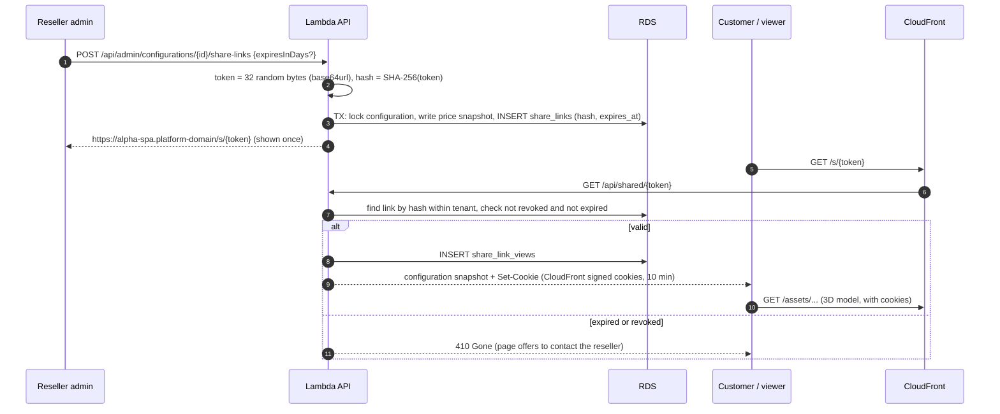

### 9.3 Share-link rules

- Token: **256 bits** from a CSPRNG, URL-safe. Only the **SHA-256 hash** is stored, so a database leak does not expose working links.
- **Expiry:** default `resellers.default_share_expiry_days` (30 days by default, A4), override 1-90 days per link; the link is invalid at `expires_at`. The reseller can **revoke** at any time (`revoked_at`).
- A link opens a **read-only snapshot** of a locked configuration, with its price at lock time, the room placement, and the AR button. No account is required.
- Views are logged with the time and a coarse device class only (**no IP address stored**).
- Rate limit on `/api/shared/*` per IP at the WAF to stop token guessing; with 256-bit tokens guessing is infeasible anyway.

### 9.4 Request workflow (Diagram 11)

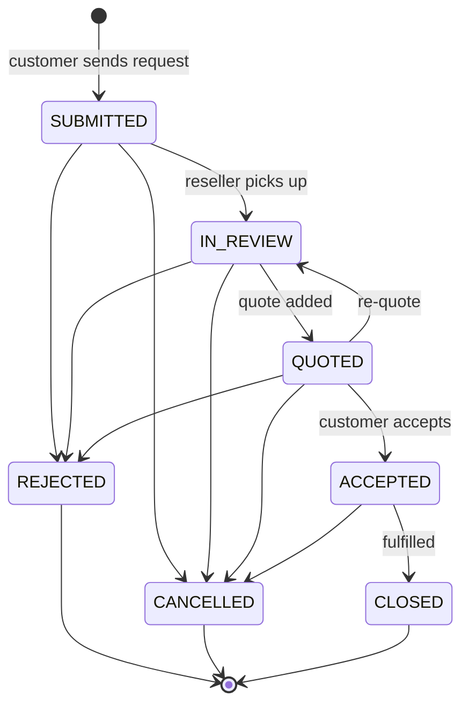

The allowed transitions live in the table `request_status_transitions`, so they can be changed with a data migration and are enforced by a trigger. Every change writes a row to `request_status_history` with the actor, and an e-mail event to the outbox. The three outputs requested ("an email, a status workflow, or just a list in their panel") are all provided: the reseller panel lists requests (filter by status, search by customer), each request has its workflow and history, and every transition sends e-mail.

---

## 10. 3D assets: protection and AR

### 10.1 The honest limit

If a browser can render a 3D model, the browser has downloaded it. **No scheme can make assets truly undownloadable.** The goal is therefore to **make bulk scraping, hotlinking and casual download impractical, keep high-quality files away from anonymous users, and limit what leaks if someone does extract a file.** The product owner should accept this limit explicitly; promising "undownloadable" to the manufacturer would be wrong.

### 10.2 Layers of protection (Diagram 12)

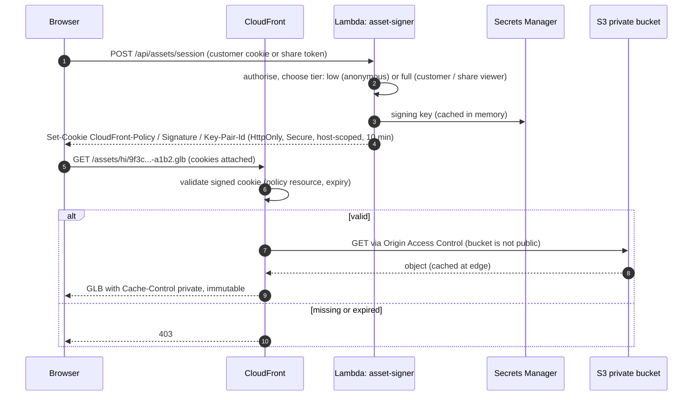

| Layer | What it does |
|---|---|
| **Private bucket + OAC** | S3 has no public access; only CloudFront (Origin Access Control) can read. SSE-KMS, versioning. |
| **CloudFront signed cookies** | Short-lived (10 min), host-scoped (valid only on that reseller's subdomain), issued by the API after authorisation. Two tiers: **low** (`/assets/lo/*`, anonymous) and **full** (`/assets/*`, logged-in customers and share-link viewers). |
| **Unguessable keys** | Keys are random plus content hash (for example `hi/9f3c…-a1b2.glb`); no listing, no sequential names. |
| **Quality gating** | Anonymous visitors only ever receive low-LOD meshes and small textures. The full-quality files are never reachable without an authenticated or share-link session. |
| **Modular parts** | The sauna is split into a base mesh plus per-option meshes and textures, loaded separately. No single file contains the complete product in full quality. |
| **Compression and stripping** | Draco or meshopt geometry, KTX2 (Basis) textures, metadata and names stripped. This helps both speed and obscurity. Lower reuse value outside the viewer. |
| **WAF** | Rate-based rules per IP on `/assets/*` and `/api/assets/session`, managed bot control on the session endpoint, CAPTCHA at sign-up. Bulk scraping becomes slow and noisy. |
| **Monitoring** | Alert on a single session or IP downloading far more asset bytes than a normal viewing session. |
| **No hotlinking** | Cookies are host-scoped and `SameSite=Lax`; assets are never embeddable cross-origin (restrictive CORS, no `Access-Control-Allow-Origin: *`). |

Not worth doing in v1: encrypting GLBs and decrypting in JavaScript (the key must reach the browser, so it only adds obscurity), and canvas-capture blockers (trivially bypassed, bad for accessibility).

### 10.3 Public assets

Thumbnails (`MODEL_THUMBNAIL`, `OPTION_THUMBNAIL`, `ROOM_THUMBNAIL`) and branding (`BRAND_LOGO`, `BRAND_FAVICON`) are **not protected** by design (`asset_roles.is_protected = false`): they are small and are needed for SEO, caching and the favicon. They live in a separate public S3 prefix behind CloudFront.

### 10.4 AR

- **iOS:** AR Quick Look needs a **USDZ** file. **Android:** Scene Viewer or WebXR uses an optimised **GLB**. Both are separate asset roles (`MODEL_AR_USDZ`, `MODEL_AR_GLB`), generated by the import pipeline.
- Implementation: Google's `<model-viewer>` web component for the AR hand-off (it covers Quick Look, Scene Viewer and WebXR), while the main 3D experience stays in React Three Fiber.
- **Protection caveat:** system AR viewers download the file themselves and may not forward cookies. AR files are therefore served through **short-lived CloudFront signed URLs (5 minutes)** with unique names, issued only to authenticated customers or share viewers. **An AR file lands on the device, so it is inherently extractable.** The same honest limit applies. Use a reduced-detail variant for AR.
- **To verify on real devices before launch:** Quick Look and Scene Viewer behaviour with signed URLs and short expiry. This is a known integration risk (section 21).

### 10.5 Rooms

Room scenes are separate GLB assets (`room_scenes` with `ROOM_GLB_LOW/HIGH`). A customer picks a room (only those assigned to the reseller, `reseller_room_scenes`), places the configured sauna (position, rotation, scale), and the placement is saved with the configuration so shared links show the same view.

---

## 11. Lazy loading and frontend performance

### 11.1 Loading pipeline (Diagram 13)

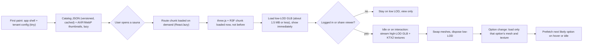

### 11.2 Techniques

| Area | Technique |
|---|---|
| Code splitting | Route-level `React.lazy` and `Suspense`; the 3D bundle (three.js, R3F, drei, decoders) is a separate chunk that is **not** loaded for the catalog or admin pages. Admin panels are separate chunks from the storefront. |
| Images | AVIF with WebP fallback, `srcset`, `loading="lazy"`, `IntersectionObserver` for catalog cards, intrinsic dimensions to avoid layout shift. |
| 3D streaming | Low-LOD first, then high-LOD in the background; textures at 1k by default and 2k on zoom; per-option meshes loaded on demand; decoders (Draco, meshopt, Basis transcoder) loaded lazily in web workers. |
| Rendering cost | `frameloop="demand"` (render only when something changes), capped device pixel ratio, instancing for repeated parts, geometry and texture disposal on unmount, adaptive quality on low-end devices. |
| Perceived speed | Thumbnail placeholder behind the canvas, progress indicator tied to real loader progress, skeleton screens for lists. |
| Prefetching | Hover and idle prefetch of the next route chunk and the next likely option; `fetchpriority` hints for the hero asset. |
| Budgets (enforced in CI) | App shell JS ≤ 150 kB gzip; catalog page LCP ≤ 2.5 s on a mid-range phone with a fast 4G profile; first visible 3D (low LOD) ≤ 3 s on the same profile; no layout shift above 0.1. Treat as targets to validate, not measured results. |

---

## 12. Caching strategy

### 12.1 Layers (Diagram 14)

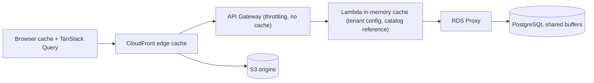

### 12.2 What is cached where

| Resource | Browser | CloudFront | Lambda memory | Invalidation |
|---|---|---|---|---|
| App bundle (hashed file names) | 1 year, immutable | 1 year | n/a | New file names per release; only `index.html` is `no-cache` |
| `GET /api/tenant` (branding, currency, `catalog_version`) | 60 s | 60 s (key includes host) | 60 s | Short TTL is enough |
| `GET /api/catalog?v={catalog_version}` and sauna details | immutable | **1 year**, because the URL includes the version | tenant-keyed | **Version bump** on any change (triggers, section 8.3); old URLs are simply never requested again. No CDN invalidation calls needed. |
| Thumbnails and branding images | 1 year, immutable (hashed names) | 1 year | n/a | New hashed file name |
| Protected 3D assets | `private, max-age=31536000, immutable` | cached at the edge; **access control (signed cookie) is checked on every request even on a cache hit** | n/a | New hashed keys per revision |
| Share-link snapshot | `no-store` | not cached | n/a | Expiry and revoke must apply immediately |
| Customer data, requests, any `POST/PUT/PATCH/DELETE` | `no-store` | not cached | n/a | n/a |
| Tenant resolution slug → reseller | n/a | KeyValueStore (edge) | 60 s | Updated by the worker on create/suspend |

Rules: cache keys always include the **Host**, so tenants never share cached responses; `Vary` is explicit; `Set-Cookie` and personalised responses are never cached; conditional requests (`ETag`, `If-None-Match`) are supported on catalog endpoints.

**Optional later:** ElastiCache (Valkey/Redis) is not needed at this scale; the versioned CDN cache covers the read-heavy catalog. Add it only if database metrics prove a need.

---

## 13. API design

**Conventions:** JSON over HTTPS on the tenant's own host (`https://{slug}.<platform-domain>/api/...`); OpenAPI 3.1 spec as the source of truth and generated TypeScript client and validators; errors use `application/problem+json` (RFC 9457) with a stable `code`; list endpoints use **cursor pagination**; all timestamps are ISO-8601 UTC; every response carries a `x-request-id`; state-changing endpoints require the CSRF token. Locking, requesting and sharing are **idempotent by database constraint** (one request per configuration, a locked configuration is already locked), so client retries are safe.

### 13.1 Public (tenant from the host, no login)

| Method | Path | Purpose |
|---|---|---|
| GET | `/api/tenant` | Branding, currency, `catalog_version` |
| GET | `/api/catalog?v=` | Visible saunas with list price, discounted price, thumbnails |
| GET | `/api/catalog/saunas/{slug}?v=` | Specs, option groups and options (read-only), prices |
| GET | `/api/rooms?v=` | Rooms the reseller offers |
| GET | `/api/shared/{token}` | Snapshot of a shared configuration; sets the asset cookie |
| POST | `/api/assets/session` | Issues signed asset cookies (low tier anonymous, full tier authenticated) |

### 13.2 Customer authentication and account

| Method | Path | Purpose |
|---|---|---|
| POST | `/api/auth/signup`, `/confirm`, `/resend-code` | Sign-up with consents; e-mail verification |
| POST | `/api/auth/login`, `/logout`, `/refresh` | Session cookies |
| POST | `/api/auth/forgot-password`, `/reset-password` | Password reset |
| GET, PATCH | `/api/me` | Profile |
| GET, POST, PATCH, DELETE | `/api/me/addresses[/{id}]` | Addresses |
| PUT | `/api/me/consents` | Consent changes (logged) |
| GET | `/api/me/export` | GDPR data export |
| DELETE | `/api/me` | GDPR erasure (anonymisation, section 15) |

### 13.3 Customer configuration

| Method | Path | Purpose |
|---|---|---|
| GET, POST | `/api/configurations` | List own history, create a draft |
| GET, PATCH, DELETE | `/api/configurations/{id}` | Read, rename, delete (drafts only) |
| PUT | `/api/configurations/{id}/selections` | Set options (validated by rules) |
| PUT | `/api/configurations/{id}/room` | Room placement |
| GET | `/api/configurations/{id}/price` | Live price |
| POST | `/api/configurations/{id}/clone` | New draft from a locked configuration |
| POST | `/api/configurations/{id}/requests` | Lock and send a request |
| GET | `/api/me/requests`, `/api/me/requests/{id}` | Own requests with status history |
| POST | `/api/me/requests/{id}/cancel`, `/accept` | Customer transitions |

### 13.4 Reseller admin (`/api/admin/...`, staff pool, MFA)

| Method | Path | Purpose |
|---|---|---|
| GET, PATCH | `/api/admin/branding` | Read and update branding; `POST /api/admin/branding/uploads` returns a presigned PUT |
| GET, PATCH | `/api/admin/settings` | Default share expiry |
| GET | `/api/admin/saunas` | Assigned saunas with list price, cap and current discount |
| PATCH | `/api/admin/saunas/{id}` | Visibility and order |
| PUT, DELETE | `/api/admin/saunas/{id}/discount` | Per-sauna discount (validated against the cap) |
| PUT, DELETE | `/api/admin/discount` | Default discount |
| POST | `/api/admin/configurations` | Configure on behalf of a customer or draft |
| POST, GET, DELETE | `/api/admin/configurations/{id}/share-links[/{linkId}]` | Create, list, revoke links |
| GET | `/api/admin/requests`, `/api/admin/requests/{id}` | Filter by status, search |
| POST | `/api/admin/requests/{id}/transition` | Status change with note |
| POST | `/api/admin/requests/{id}/notes`, `PUT /quote` | Internal note, quote |
| GET | `/api/admin/customers`, `/api/admin/customers/{id}` | Own customers |
| GET | `/api/admin/analytics` | Views, requests, conversion for own reseller |

### 13.5 Manufacturer admin (`admin.<platform-domain>/api/manufacturer/...`)

| Method | Path | Purpose |
|---|---|---|
| GET, POST | `/api/manufacturer/resellers` | List, create (slug, currency, owner invite) |
| GET, PATCH | `/api/manufacturer/resellers/{id}` | Details, suspend, reactivate |
| GET, PUT, DELETE | `/api/manufacturer/resellers/{id}/saunas[/{saunaId}]` | Assign and unassign saunas |
| PUT | `/api/manufacturer/resellers/{id}/rooms` | Assign rooms |
| GET | `/api/manufacturer/saunas` | Catalog (read-only) |
| PUT | `/api/manufacturer/saunas/{id}/prices/{currency}` | List ("max") price and max discount |
| PUT | `/api/manufacturer/saunas/{id}/options/{optionId}/prices/{currency}` | Option price delta |
| GET | `/api/manufacturer/analytics` | Cross-reseller metrics (no PII) |
| GET | `/api/manufacturer/audit` | Audit events |

### 13.6 Limits

Throttling at API Gateway (account and stage defaults, tightened per route), per-IP rate rules at the WAF, request body limits (for example 1 MB JSON), upload limits via presigned PUT conditions (type and size).

---

## 14. Notifications

**Pattern:** transactional outbox. The business change and the `notification_outbox` row are written in **one database transaction**, so an e-mail is never lost or sent for a rolled-back change. The `worker` function drains the outbox into SQS (with a dead-letter queue) and sends through **SES in `eu-central-1`**.

| Event | Recipient | Content |
|---|---|---|
| Customer sign-up and password reset | Customer | Cognito sends the code; a `CustomMessage` trigger applies the reseller's branding using `ClientMetadata` passed by the API |
| Request submitted | Reseller admins + customer confirmation | Summary, price snapshot, link to the panel or history |
| Status changed, quote added | Customer | New status, optional note, quote |
| Share link created | Optionally to the customer | Link and expiry date |
| Reseller invited | Reseller owner | Staff-pool invitation, MFA setup |

E-mail hygiene: domain-verified SES identity with DKIM, SPF and DMARC; SES event publishing to SNS; **bounces and complaints are written to `email_suppressions` and honoured**; send-rate and bounce-rate alarms (section 17); templates are versioned in the repository and support localisation (A16).

---

## 15. Security, privacy and GDPR

### 15.1 Application security

- **OWASP ASVS** as the checklist; WAF managed rule groups (core, known bad inputs, SQLi, IP reputation, bot control on sensitive routes).
- **Input validation** with schema validation (Zod) on every endpoint; parameterised SQL only; output encoding in React; CSP with nonces, `frame-ancestors 'none'`, HSTS (preload), `X-Content-Type-Options`, `Referrer-Policy`.
- **Reseller-supplied content** (display name, branding values) is treated as untrusted: escaped everywhere, images re-encoded, SVG rejected.
- **Secrets** in Secrets Manager, KMS customer-managed keys, automatic rotation where supported; no secrets in environment files or the repository.
- **IAM least privilege**, one role per function; **IAM database authentication** (no static DB passwords in code).
- **Origin lock:** API Gateway only accepts requests carrying a rotating secret origin header added by CloudFront (verified by every function). CloudFront → Lambda Function URLs with OAC is the alternative.
- **Staff accounts:** MFA mandatory, short sessions, audit trail for every price, discount, assignment and status change (`audit_events`, append-only).
- **Dependency and supply chain:** lockfiles, automated dependency updates and audits, container-less Lambda packaging with SBOM, GitHub OIDC (no long-lived AWS keys).

### 15.2 Tenant isolation threats

| Threat | Control |
|---|---|
| Customer of reseller A reads reseller B data (IDOR) | RLS on every tenant table; host-derived tenant; cross-tenant test for every endpoint |
| Reseller raises or lowers price outside limits | Server-side pricing, DB trigger on discounts, DB grants (tenant role cannot write prices) |
| Reseller reaches a protected asset of another reseller | Host-scoped signed cookies; unguessable keys |
| Compromised customer Lambda escalates to platform | Separate DB roles and IAM roles; platform privilege only by DB role membership |
| Share-link guessing | 256-bit tokens, stored as hashes, WAF rate limits, expiry and revoke |

### 15.3 GDPR and data residency (not legal advice; confirm with counsel)

- **Residency:** RDS, S3, Cognito, SES, SQS, Secrets Manager and backups are in **EU regions** (Frankfurt primary, Ireland for copies). CloudFront serves from edge locations globally; it only caches **non-personal** content (assets, public catalog), and personal data is never cached at the edge. ACM certificates for CloudFront must be created in `us-east-1`; this holds no personal data.
- **Roles:** the reseller is the controller of its customers' data; the platform operators are processors (and the manufacturer a separate party, see A10). Data-processing agreements and a sub-processor list (AWS) are required.
- **Customer rights:** export (`/api/me/export`) and erasure (`DELETE /api/me`). Erasure **anonymises** the customer row (e-mail replaced by a non-routable placeholder, names and phone removed, addresses deleted, Cognito user deleted); consent history is kept without identifying data; configurations and requests needed for business records remain linked only to the anonymised row.
- **Consent log:** versioned, timestamped consent records for terms, privacy and marketing; marketing is opt-in.
- **Minimisation:** no IP addresses stored in share-link views; no third-party trackers by default; auth cookies and asset cookies are strictly necessary. A legal review should confirm whether any banner is required.
- **Retention (proposed defaults, to confirm with counsel):** inactive customer accounts flagged after 24 months; share-link views 13 months; audit events 24 months; sent outbox rows 30 days; request records per the reseller's legal retention period.
- **Breach readiness:** incident runbook with the 72-hour notification clock; CloudTrail, WAF and application logs retained for investigation.
- **Encryption:** TLS in transit; KMS-encrypted RDS, S3, SQS and backups.

---

## 16. Capacity and scalability

**Inputs:** 500 resellers, 1 M customer accounts (accounts, not concurrent), and the **assumed** peak of 2,000 concurrent sessions (A2) with headroom to 5,000. These are estimates to validate with load tests.

| Area | Estimate and sizing |
|---|---|
| API load | A configuring user makes about one API call every 5 seconds, so about 400 requests/s at 2,000 concurrent users, of which a large part is served by the CDN (catalog, assets). Assume about 100-150 req/s reach Lambda. |
| Lambda | With about 100 ms average duration, about 15-40 concurrent executions. Reserved concurrency per function protects the database; the account default quota (1,000) is ample, and can be raised. Provisioned concurrency only on the two latency-critical functions if cold starts matter in measurements. ARM64 (Graviton), Node.js LTS, bundled with esbuild, to keep cold starts short. |
| Database | About 3 queries per request, so about 300-500 queries/s peak, mostly index lookups. **Start: `db.r6g.large`, Multi-AZ, gp3 storage with autoscaling**; scale up by one size or add a **read replica** for analytics. RDS Proxy absorbs Lambda connection churn. Verify with load tests, not assumptions. |
| Storage | Database: low tens of GB in year one (7.7). S3: assets are the bulk (hundreds of saunas, each tens of MB across variants); plan terabytes at most, which is cheap. |
| Egress | Largest cost driver. Illustration: 20,000 sessions/day × 12 MB first-visit average ≈ 240 GB/day ≈ 7 TB/month before browser caching. Draco/KTX2/LOD, immutable caching and the low-LOD-first approach directly reduce this. Check the CloudFront pricing calculator, and consider a CloudFront savings bundle once usage is stable. |
| Cognito | Cost depends on monthly **active** users and the plan; most of 1 M accounts will not be active in any month. Verify current pricing (A14). |
| Growth path | Stateless Lambdas scale out; the first bottleneck is the database. Order of response: index and query tuning, RDS Proxy settings, larger instance, read replica for reporting, monthly partitioning of `share_link_views`. |

**Load-test scenarios (k6, section 20):** catalog browse (CDN-heavy), sign-up and login burst, configure-and-price loop, asset session issuance, share-link opening spike (for example a reseller sends a link to 2,000 people), manufacturer price change plus catalog version bump while under load.


---

## 17. Observability and operations

- **Logging:** structured JSON, one `x-request-id` per request, propagated to every log line; tenant slug and role in each line; **no personal data or tokens in logs**. CloudWatch Logs with retention policies.
- **Metrics:** custom metrics through the Embedded Metric Format (requests, latency, pricing time, asset sessions, share links created and opened, sign-ups, requests by status per reseller).
- **Tracing:** AWS X-Ray or OpenTelemetry across CloudFront → API Gateway → Lambda → RDS.
- **Dashboards:** API, database, assets, auth, e-mail, per-reseller usage.
- **Service targets (proposed):** availability 99.9 %; API p95 < 300 ms; catalog from edge < 200 ms; asset session issuance p95 < 200 ms.
- **Alarms:** 5xx rate, p95 latency, Lambda throttles and errors, RDS CPU, connections, freeable memory, free storage, replica lag, **RDS Proxy session pinning**, SQS dead-letter depth, SES bounce and complaint rates, WAF blocked-request spikes, CloudFront 5xx, certificate expiry, AWS Budgets, abnormal asset download volume per session.
- **Runbooks:** reseller onboarding, suspending a reseller, rotating the CloudFront signing key and origin secret, restoring the database, handling a bounce spike, handling a suspected asset leak, GDPR requests.

---

## 18. Delivery: IaC, CI/CD, environments, catalog import

### 18.1 Environments

Separate **AWS accounts** per environment under AWS Organizations: `dev`, `staging`, `prod`. Staging mirrors production topology at smaller size and is used for load tests. Preview environments for pull requests are optional.

### 18.2 CI/CD (Diagram 15)

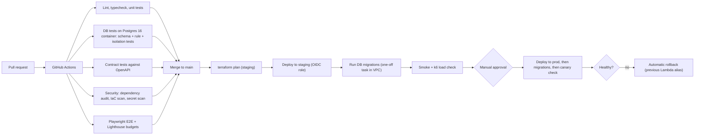

- Deployments use **Lambda versions and aliases** with weighted (canary) shifting and automatic rollback on alarms.
- **Database migrations** are forward-only, backward-compatible (expand, then contract) and applied by a one-off task inside the VPC; the first migration is `schema.sql`.
- The frontend is published to S3 with hashed file names; `index.html` is the only non-immutable file; invalidating only `index.html` is enough.

### 18.3 Infrastructure as code

Terraform modules: `network`, `database` (RDS, Proxy, parameter groups), `auth` (two Cognito pools, triggers), `api` (API Gateway, Lambdas, IAM), `edge` (CloudFront, WAF, Route 53, ACM, KeyValueStore), `storage` (buckets, KMS, replication), `messaging` (SQS, SES, SNS), `observability`. State in a locked, versioned S3 backend.

### 18.4 Catalog import pipeline (Diagram 16)

This is how the maintainers add saunas **without redeploying the application** (the "dynamic onboarding" requirement, honoured as a data pipeline rather than an admin UI):

```mermaid
flowchart LR
  A["Maintainer: new sauna manifest (YAML) + source model files"] --> B["catalog-import CLI in CI"]
  B --> C["Validate: manifest schema, glTF validator, naming, option rules"]
  C --> D["Optimise: LOD generation, Draco/meshopt, KTX2, strip metadata"]
  D --> E["Convert AR files: GLB and USDZ"]
  E --> F["Upload to private S3 with hashed unguessable keys"]
  F --> G["DB transaction as catalog_admin: models, options, prices, assets, rules"]
  G --> H["bump_all_catalog_versions()"]
  H --> I["Smoke test on staging, then repeat on prod after approval"]
```

Manifest sketch (checked into the repository, reviewed like code):

```yaml
sauna:
  sku: S-100
  slug: cedar-100
  name: Cedar 100
  status: ACTIVE
  attributes: { width_mm: 2200, depth_mm: 1800, heater_kw: 6.0, capacity_persons: 4 }
  prices:
    EUR: { list_price: 12900.00, max_discount_pct: 15 }
    SEK: { list_price: 139000.00, max_discount_pct: 15 }
  option_groups:
    wood:  { selection: SINGLE, required: true,  options: [cedar, spruce, thermo-ash] }
    extras: { selection: MULTI, required: false, options: [led-lights, audio] }
  option_prices:
    EUR: { thermo-ash: 900.00, led-lights: 250.00, audio: 400.00 }
  rules:
    requires: [{ audio: led-lights }]
    excludes: [{ spruce: thermo-ash }]
  assets:
    model_high: ./models/cedar-100.glb
    ar_usdz: ./models/cedar-100.usdz
    thumbnail: ./images/cedar-100.png
```

The importer is **idempotent** (re-running with the same manifest changes nothing) and runs in one transaction per sauna, so a failed import leaves no half-sauna behind.

**Reseller onboarding** (manufacturer panel): create the reseller (slug, currency, owner e-mail) → the system writes the row, the KeyValueStore entry and sends the owner's invitation → the manufacturer assigns saunas and rooms (each must have a price in the reseller's currency, enforced by the database) → the storefront is live on `{slug}.<platform-domain>` immediately.

---

## 19. Backup and disaster recovery

| Component | Protection |
|---|---|
| RDS | Multi-AZ synchronous standby (automatic failover, typically within a couple of minutes); automated backups with **point-in-time recovery** (retention 14-35 days); daily AWS Backup copy to `eu-west-1`; deletion protection on; encrypted. |
| S3 assets | Versioning, cross-region replication to `eu-west-1`, lifecycle rules for old versions. The **source model files** are also kept in the maintainers' repository and storage, so assets can always be regenerated. |
| Infrastructure | Terraform state versioned; the whole stack can be recreated in another region from code. |
| Secrets and keys | Secrets Manager replication for the signing key; documented rotation. |
| Targets (proposed) | Single AZ failure: RPO ≈ 0, RTO of a few minutes. Database corruption or operator error: RPO of about 5 minutes via PITR. Whole region loss: RPO ≤ 24 h (daily cross-region copy), RTO of several hours, rehearsed with a documented runbook. Tighten the regional RPO with a cross-region read replica if the business requires it. |
| Drills | Restore test each quarter; a regional-failover game day before launch and then twice a year. |

---

## 20. Testing strategy

| Level | What |
|---|---|
| Unit | Pricing engine (property-based tests: discount never exceeds the cap, final never negative, integer arithmetic), option rule evaluation, token and cookie signing, input schemas |
| Database | The schema and rule suite described in 7.8, ported to a Postgres 16 container in CI, plus migration up/down checks |
| **Tenant isolation** | For **every endpoint**, a test that authenticates as tenant A and tries to read or change tenant B's objects, expecting 404 or 403 and zero rows; also fail-closed with no tenant context |
| Contract | The OpenAPI spec versus handlers (request and response validation) |
| End-to-end | Playwright: sign-up and verify, login, reset password, configure, price, lock, request, status flow, share link (valid, expired, revoked), reseller discount within and above the cap, branding and favicon per subdomain |
| Frontend performance | Lighthouse CI against the budgets in 11.2; 3D smoke test on mobile emulation |
| Load | k6 scenarios in section 16 on staging; watch RDS Proxy pinning, Lambda throttles, p95 latency |
| Security | Dependency audit, IaC scanning, secret scanning, OWASP ZAP baseline in CI; **external penetration test before launch** with special attention to tenant isolation and asset protection |
| Device | AR on real iOS and Android devices (signed URLs, Quick Look and Scene Viewer), common browsers, low-end phone for 3D |
| Resilience | Fault injection: kill an AZ, exhaust Lambda concurrency, SES failure (outbox must retry), restore from backup |

---

## 21. Risks

| # | Risk | Impact | Mitigation |
|---|---|---|---|
| R1 | "Assets not downloadable" expectation cannot be fully met | Client disappointment | State the limit up front (10.1); layered controls; low-LOD for anonymous; monitoring |
| R2 | AR files must be fetched by OS viewers and can't rely on cookies | Weaker protection and integration bugs | Short-lived signed URLs, reduced AR variants, early device testing |
| R3 | Cognito cost or limits at 1 M accounts | Budget | Verify pricing early (A14); keep auth behind the BFF so a swap is local; fallback design on the same schema |
| R4 | RDS Proxy pinning from session state | Connection exhaustion | Transaction-local settings only; pinning alarm; fallback pool |
| R5 | 3D performance on low-end phones | Poor conversion | LOD, KTX2, adaptive quality, budgets in CI, early device lab |
| R6 | Manufacturer expects to see customer data | Legal or contract conflict | Decide A10 early; the schema supports aggregate-only access today |
| R7 | Tenant leakage bug | Severe | RLS, composite FKs, mandatory isolation tests, pen test |
| R8 | Catalog volume (hundreds of 3D saunas) makes importing slow or error-prone | Delays | Automated, validated, idempotent importer; manifest reviews; asset budgets enforced at import |
| R9 | Model size larger than assumed | Egress cost, slow loads | Validate A3 on a real model before finalising budgets |
| R10 | Wildcard subdomain abuse (phishing on reseller names) | Brand risk | Reserved slugs, manufacturer-only reseller creation, suspend switch, abuse contact |
| R11 | VAT and pricing display rules differ per EU country | Compliance | Decide A12; v1 shows prices as entered with a clear label |

---

## 22. Roadmap

| Phase | Scope | Exit criteria |
|---|---|---|
| **0. Decisions** | Close the bold items in section 2 (peak users, model size, expiry, domain, VAT, e-mail sender, PII access, Cognito pricing) | Signed-off assumptions |
| **1. Foundations** | AWS accounts, Terraform baseline, CI/CD, database and migrations, edge (wildcard TLS, CloudFront, WAF), tenant resolution, observability skeleton | Empty tenant page served on a reseller subdomain; isolation tests green in CI |
| **2. Identity** | Cognito pools, BFF, sign-up, login, reset, staff invitations with MFA, customer profile and consents | E2E auth flows pass; account enumeration tests pass |
| **3. Catalog and viewer** | Importer, first real sauna imported, catalog API, 3D viewer with LOD and lazy loading, signed-cookie asset delivery | Real sauna viewable on a mid-range phone within the budgets |
| **4. Configuration and pricing** | Option rules, pricing engine, discounts, snapshots, rooms, saved history | Property tests green; price matches manual calculation |
| **5. Sharing and requests** | Share links with expiry, request workflow, e-mail, reseller panel lists | Full request lifecycle E2E, including e-mail |
| **6. Manufacturer and branding** | Reseller creation and assignment, list prices and caps, branding and favicon, analytics | Onboard a pilot reseller in under 10 minutes without engineering help |
| **7. AR and hardening** | AR assets and device tests, load tests, pen test, DR drill, runbooks | All checklist items in section 24 |
| **v2 candidates** | Catalog admin UI, reseller custom domains, VAT handling, payments and checkout, per-tenant link previews, Open Graph rendering at the edge, reseller team management, analytics export | |

---

## 23. Repository layout

```text
sauna-platform/
├── README.md
├── apps/
│   └── web/                  # React + Vite + TypeScript SPA (storefront, customer, reseller admin, manufacturer admin)
│       └── src/
│           ├── routes/       # code-split per route
│           ├── three/        # React Three Fiber scenes, loaders, LOD logic
│           └── ar/           # model-viewer wrapper
├── services/
│   ├── api/                  # Lambda handlers (Hono), one entry per function
│   │   ├── public-catalog/
│   │   ├── customer/
│   │   ├── reseller-admin/
│   │   ├── manufacturer-admin/
│   │   ├── asset-signer/
│   │   └── worker/
│   └── cognito-triggers/     # CustomMessage, PreSignUp
├── packages/
│   ├── db/                   # schema.sql, migrations, DB tests, query layer
│   ├── pricing/              # pure pricing engine + property tests
│   ├── rules/                # option rule evaluation
│   └── shared/               # Zod schemas, generated OpenAPI client
├── tools/
│   └── catalog-import/       # manifest validation, optimisation, upload, DB import
├── infra/
│   ├── modules/              # network, database, auth, api, edge, storage, messaging, observability
│   └── envs/                 # dev, staging, prod
└── .github/workflows/
```

---

## 24. Launch checklist

- [ ] All bold assumptions in section 2 resolved and recorded
- [ ] `schema.sql` applied via the migration pipeline on staging **and** the database test suite green on Postgres 16
- [ ] Tenant-isolation tests pass for every endpoint; pen test findings closed
- [ ] Load tests meet the targets in section 16; RDS Proxy pinning checked
- [ ] Asset protection verified: private bucket, signed cookies, anonymous low tier only, no public listing; AR tested on real devices
- [ ] Data-processing agreements, sub-processor list, privacy notice, consent texts and retention periods approved by counsel
- [ ] Backup restore and regional failover drills completed
- [ ] SES domain verified (DKIM, SPF, DMARC), bounce handling live, production access granted
- [ ] Alarms, dashboards, on-call and runbooks in place
- [ ] Wildcard DNS and certificate live; unknown-slug behaviour verified
- [ ] First sauna imported through the pipeline; pilot reseller onboarded end to end
- [ ] Budgets and cost alarms set

---

## 25. Diagram index

| # | Diagram | Section |
|---|---|---|
| 1 | System context | 4.1 |
| 2 | AWS architecture | 4.2 |
| 3 | Network and security layers | 4.3 |
| 4 | Tenant resolution sequence | 5.1 |
| 5 | Authentication flows | 6.2 |
| 6 | ERD: identity and tenancy | 7.3 |
| 7 | ERD: catalog, pricing and assignment | 7.3 |
| 8 | ERD: configuration, sharing and requests | 7.3 |
| 9 | Pricing calculation flow | 8.2 |
| 10 | Share, view and request sequence | 9.2 |
| 11 | Request status state machine | 9.4 |
| 12 | Asset protection sequence | 10.2 |
| 13 | Loading and lazy-loading pipeline | 11.1 |
| 14 | Caching layers | 12.1 |
| 15 | CI/CD pipeline | 18.2 |
| 16 | Catalog import pipeline | 18.4 |/mnt/project-files/uploads/:
hearth

/mnt/project-files/uploads/hearth/:
0b881ab4-e989-462d-b805-07ddc38543dd
